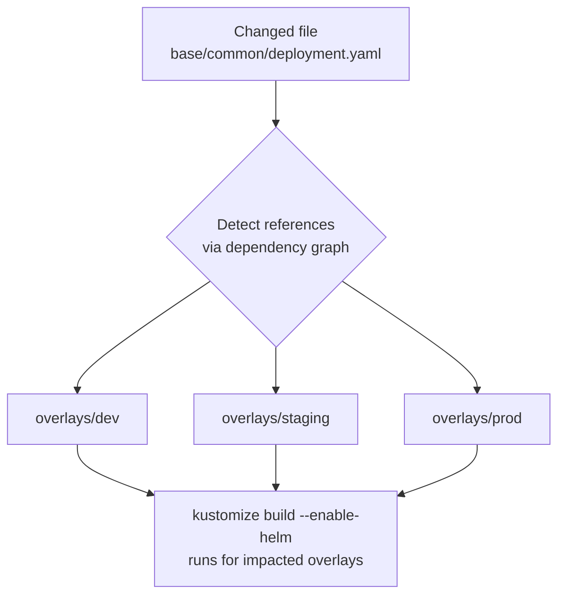

# kustomize-build-check-action

A GitHub Action that runs `kustomize build` on the Kustomize overlays a change affects. A change to a
base builds every overlay that uses it. A change to an overlay builds only that overlay. Helm charts
are inflated by default.

## Usage

Copy one of the example workflows into `.github/workflows/`:

- [basic.yml](examples.d/basic.yml) checks every pull request.
- [custom-base-ref.yml](examples.d/custom-base-ref.yml) compares against the pull request's base commit.
- [continue-on-error.yml](examples.d/continue-on-error.yml) keeps the job green and posts the counts as a pull request comment.
- [monorepo.yml](examples.d/monorepo.yml) runs one job per changed project directory.
- [with-kubeconform.yml](examples.d/with-kubeconform.yml) validates the built manifests against Kubernetes schemas afterwards.

[action.yml](action.yml) lists the inputs and outputs with their defaults.

Check out with `fetch-depth: 0` so the base commit is available. When the action cannot resolve the
base ref, for example in a shallow clone, it builds every kustomization it finds. Set
`on-unresolvable-base: fail` to stop instead.

When `base-ref` is empty, the action compares against `HEAD~1`, which covers only the last commit. Set
it to `${{ github.event.pull_request.base.sha }}` to check the whole pull request.

## What gets built

The action finds every `kustomization.yaml`, `kustomization.yml` and `Kustomization` file under
`root-dir` and records which ones reference which. For each changed file:

- A changed kustomization file marks its own directory.
- Any other changed file marks each kustomization that references it, for example as a resource, a
  patch, a generator input or a Helm values file.

Every marked kustomization is built, along with everything that depends on it. A changed file that
no kustomization references builds nothing. A kustomization the action cannot fully parse is built
on every run.

Some paths are skipped and counted in `skipped-count`: directories the change deleted or renamed, and
kustomize Components, which only build through a parent. A directory that still exists but no longer
builds is a failure. So is a build that runs longer than `build-timeout`.

## How it runs

The action runs a prebuilt image from `ghcr.io/michielvha/kustomize-build-check`, pinned by commit SHA
in [action.yml](action.yml). It needs no token. The source, design documents and issue tracker are in
[kustomize-build-check](https://github.com/michielvha/kustomize-build-check).
